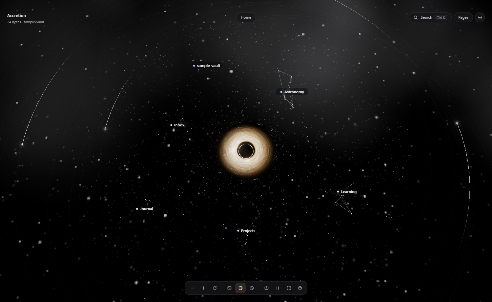
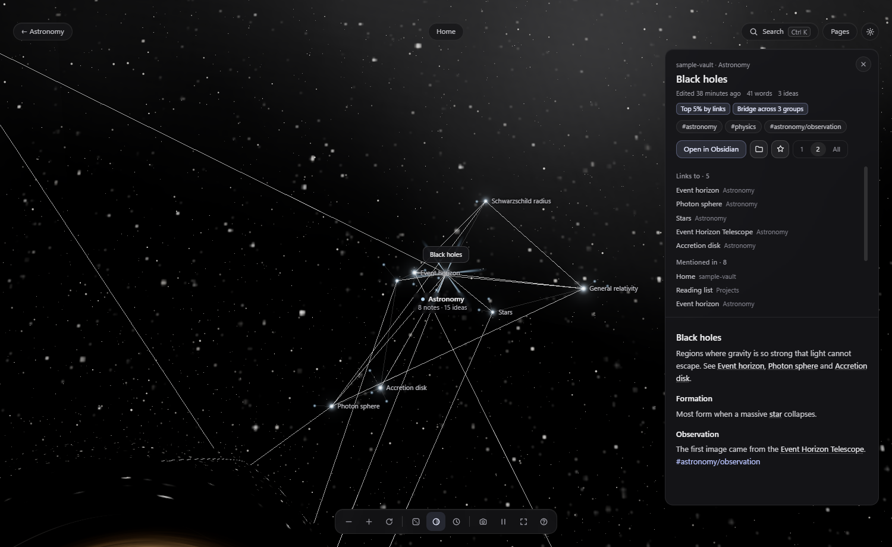
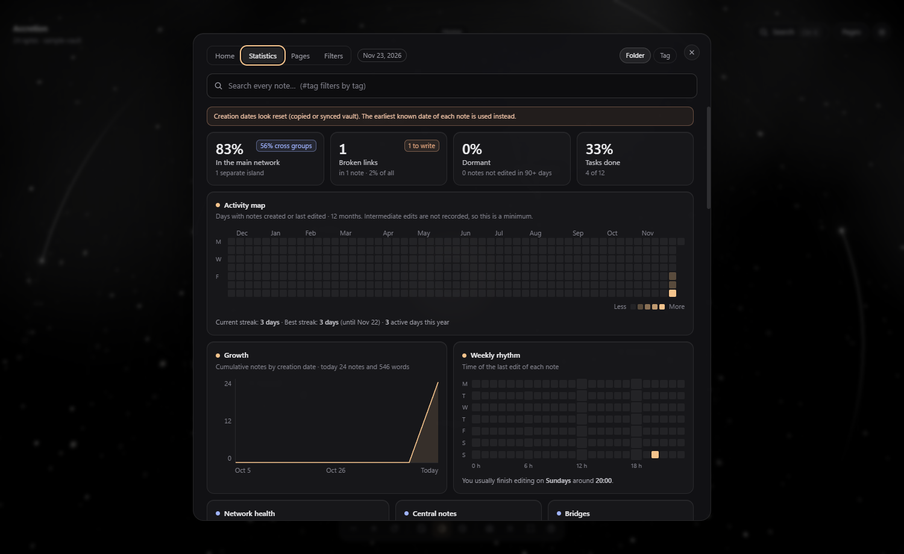

# Accretion

**Your notes, accreting around a black hole.** Explore your Obsidian vault as a 3D galaxy around a ray-traced black hole.
Every note is a star, every folder a constellation, every `[[link]]` a path of light. Local, private, offline.



<p align="center">
  
  
</p>

> Read-only by design: Accretion never modifies your notes and never sends them anywhere. No accounts, no telemetry, no network.

## Features

- **A real black hole.** The centre is a per-pixel ray-traced Schwarzschild black hole with a Doppler-beamed accretion disc and gravitational lensing of your own notes.
- **Your vault as a galaxy.** Notes become stars sized by their links; headings orbit them as small "ideas"; folders (or tags) become constellations.
- **Read notes in place.** Click a star to read it with backlinks, tags, callouts, images and embeds. `Ctrl+click` opens it in Obsidian.
- **Neighbourhood view.** Show 1 or 2 hops of links around a note, or its whole connected component.
- **Search and filters.** Accent-insensitive search with `#tag` filtering; highlight the results on the map; filter by tag, group, recency or orphans.
- **Time travel.** Scrub or play back how your vault grew over time.
- **Statistics.**
  - Activity map, growth curve and weekly rhythm.
  - Network health, central notes and "bridge" notes.
  - Broken links (notes still to write), and tags with the pairs that appear together.
  - A group comparison table, plus length, freshness and tasks.
  - A **To review** list: cited stubs, forgotten key notes, orphans and old tasks.
- **Pins, screenshots, cinema mode.** Pin notes to Home, save a clean wallpaper-ready PNG, or hide the UI.
- **English and Spanish**, keyboard-accessible, respects *reduced motion*.
- Works with Obsidian vaults **and any folder of Markdown notes**.

## Install

Download the latest build from **[Releases](https://github.com/OscarRios-dev/accretion/releases/latest)**:

| System | File | Run |
| --- | --- | --- |
| Windows 10/11 (x64) | `Accretion-<version>-win32-x64.zip` | Unzip and open `Accretion.exe` |
| macOS (Apple Silicon) | `Accretion-<version>-darwin-arm64.zip` | Unzip and move `Accretion.app` to *Applications* |
| Linux (x64) | `Accretion-<version>-linux-x64.tar.gz` | Extract and run `./Accretion` |

The builds are not code-signed yet, so the first launch needs one extra step:

- **Windows:** SmartScreen says "Windows protected your PC". Click *More info*, then *Run anyway*.
- **macOS:** right-click the app and choose *Open*. If macOS says the app "is damaged", run `xattr -cr /Applications/Accretion.app` once.
- **Linux:** if it doesn't start because of the sandbox, run `sudo chown root:root chrome-sandbox && sudo chmod 4755 chrome-sandbox` in the app folder.

Every release includes `SHA256SUMS.txt`. To check a download, compare it with `sha256sum <file>` (Linux), `shasum -a 256 <file>` (macOS) or `Get-FileHash <file>` (Windows PowerShell).

### Build from source

Requires Node.js 20+.

```bash
git clone https://github.com/OscarRios-dev/accretion.git
cd accretion
npm ci
npm start            # build and launch
npm run demo         # launch with the bundled sample vault
npm test             # unit tests
npm run package      # Windows build in dist/  (package:mac, package:linux)
```

## Keyboard shortcuts

| Keys | Action |
| --- | --- |
| `Ctrl` `K` or `/` | Search every note (`#tag` to filter) |
| `Shift` `Enter` (in search) | Highlight results on the map |
| `P` | All notes by group |
| `F` | Filters, or pin the open note |
| `A` | Random note |
| `1` `2` `0` | Neighbourhood depth of the selected note |
| `T` | Time travel |
| `B` | Fly to the black hole |
| `C` | Colour by group |
| `S` | Save screenshot |
| `R` | Pause / resume rotation |
| `H` | Cinema mode (hide UI) |
| `+` `−` | Zoom |
| `Esc` / `Home` | Close / back to overview |
| `F5` | Re-read vaults |
| `F11` | Fullscreen |
| `Ctrl` `,` | Settings |
| `Ctrl` + click | Open a star in Obsidian |

## Supported vaults and performance

- Reads `.md` files, YAML frontmatter (`tags`, `aliases`, `title`, `created`), inline `#tags`, `[[wikilinks]]` and Markdown links. It ignores code blocks, `%% comments %%` and dot-folders such as `.obsidian` and `.trash`.
- Folders can be excluded in **Settings → Ignored folders** (for example `Templates` or `Private/`). This is useful before sharing screenshots.
- Tested with vaults of up to 20,000 notes:
  - Re-scans are incremental, so only changed files are parsed again.
  - Very large vaults are capped at 50,000 notes per vault.
- The black hole is the most expensive part to draw. Graphics quality adapts automatically; on older laptops choose **Settings → Graphics quality → Low**.

## Privacy and security

- Everything runs locally. The app makes no network requests.
- Remote images in notes are shown as links and never fetched.
- Note content is treated as untrusted and sanitized before display.

See [SECURITY.md](SECURITY.md) for the threat model and how to report a vulnerability.

## Contributing

Issues and pull requests are welcome. See [CONTRIBUTING.md](CONTRIBUTING.md) for the project layout and guidelines. New statistics go in `src/stats.mjs`, and every string needs both languages in `src/locales/`.

## License

[MIT](LICENSE). Third-party licenses are listed in [THIRD_PARTY_NOTICES.md](THIRD_PARTY_NOTICES.md).

*"Obsidian" is a trademark of Dynalist Inc. This project is independent and not affiliated with or endorsed by Obsidian.*
